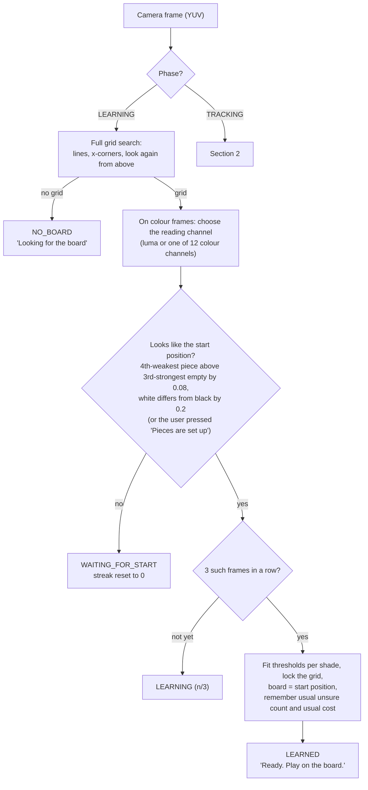
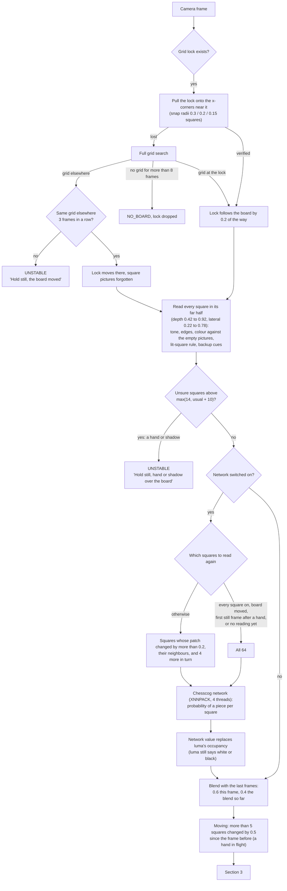
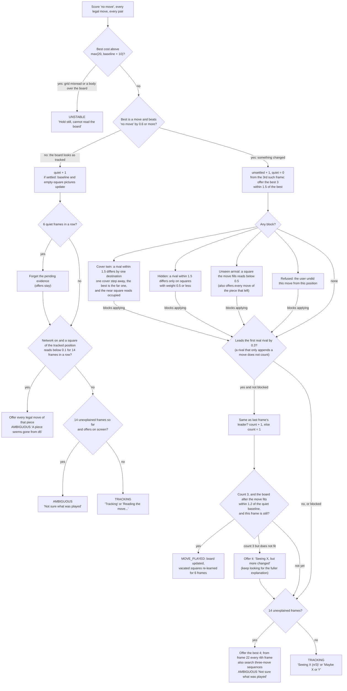
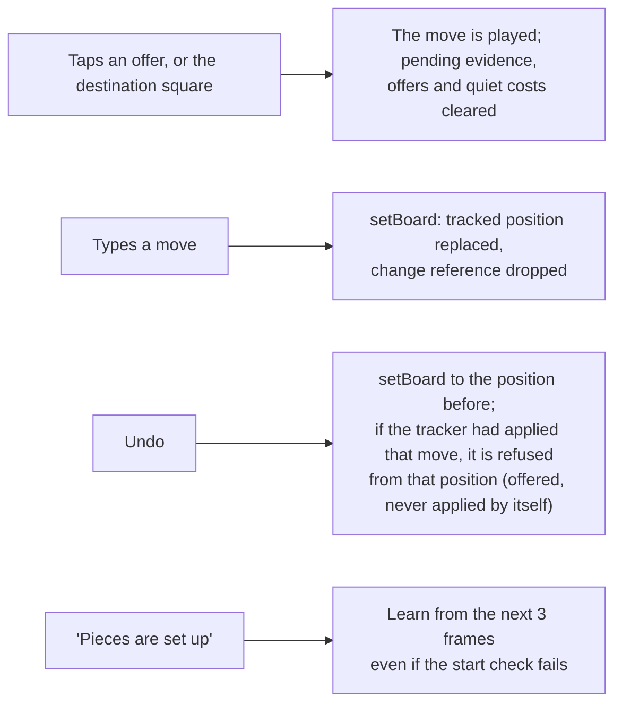

# How one frame is decided

The tracker (`core/.../vision/LiveTracker.kt`) handles one camera frame at a time, about 4 per
second. Each frame ends in exactly one status: NO_BOARD, WAITING_FOR_START, LEARNING, LEARNED,
UNSTABLE, TRACKING, MOVE_PLAYED or AMBIGUOUS. This page follows a frame from the camera to that
status, with every threshold the code uses. docs/LESSONS.md says why each value is what it is;
docs/DISMISSED.md lists what was tried instead and dropped.

## 1. Before the game: finding the board and learning the pieces

## 2. During the game: from the frame to the square readings

## 3. From the readings to a decision

Every legal move, and every pair of moves, is scored against the readings (section 4 of
LESSONS.md). Per square: expected empty pays `weight x occupied`; expected to hold a piece pays
`(1 - occupied)` in full plus `weight x occupied x wrong colour`. The weight is 1 for a square
nothing hides, and lower behind a piece in the picture (the cover map, from the homography): 0.6
behind a pawn, 0.5 behind a knight, bishop or rook, 0.35 behind a queen or king, and 1.0, 0.8 or
0.65 two squares on. Each ply adds 0.3. A square the change detector saw change, on which the
candidate changes nothing, adds 0.35 x its change score.

## 4. What the user does, and what it changes

## 5. Every number in one place

| Step | Value | Where |
|---|---|---|
| Start check | 4th-weakest piece above 3rd-strongest empty by 0.08; colour gap 0.2; 3 frames | `learn` |
| Grid tracking | snap radii 0.3 / 0.2 / 0.15 squares, follow 0.2, relock after 3 frames, drop after 8 without a grid | `cornersForFrame` |
| Hand or shadow | unsure squares above max(14, usual + 10) | `track` |
| Network refresh | change score 0.2, neighbours, 4 squares in turn; all 64 after a hand | `classify` |
| Smoothing | 0.6 this frame | `smooth` |
| Moving | more than 5 squares changed by 0.5 | `track` |
| Square weight behind a piece | pawn 0.6 / 1.0, minor or rook 0.5 / 0.8, queen or king 0.35 / 0.65 | `CoverMap` |
| Ply penalty | 0.3 | `MoveInference` |
| Change evidence | 0.35 x change score on untouched squares | `MoveInference` |
| Misread frame | best cost above max(20, baseline + 10) | `track` |
| A change at all | best beats "no move" by 0.6 | `minEvidence` |
| Apply margin | 0.3 over the first real rival, 3 frames, still frame | `applyMargin`, `framesToConfirm` |
| Fits the baseline | within 1.2 of the median "no move" cost of the last 8 settled frames | `applySlack` |
| Cover twins, hidden rivals | within 1.5 | `twinMargin` |
| Unseen arrival | filled square below 0.5 | `arrivalMin` |
| Piece gone | below 0.1 for 14 frames (network only) | `vanishedMax` |
| Offers | from the 3rd unexplained frame, best 3 within 1.5; at most 10 | `offer` |
| Ask | after 14 unexplained frames; three-move search from 22, every 4th frame | `framesBeforeAsking` |
| Settled | 6 quiet frames in a row | `quietFramesToSettle` |
| Empty-square pictures | learned below 0.2, three tenths per quiet frame; vacated squares 6 frames regardless | `templates` |
